## EXAMEN 02 INTERFAZ David Matthieu Pineda Reyna
 

---
[Pregunta1](#Pregunta1)
[Pregunta2](#Pregunta2)
[Pregunta3](#Pregunta3)

---

#Pregunta1

Prompt inicial:
Resume estas resenas
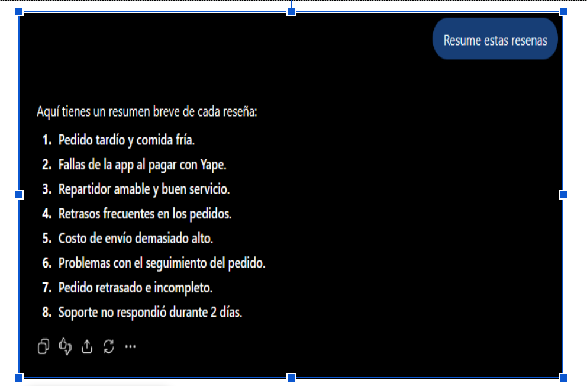

Prompt final:

Prompt nuevo[Actúa como analista de experiencia de cliente de una startup de delivery llamada RutaFácil.

Contexto: el jefe de producto recibe cientos de reseñas por semana y necesita decidir qué corregir primero. Te entrego una muestra de exactamente 8 reseñas.

Tarea: analiza en dos pasos.

PASO 1. Tabla de clasificación: una fila por reseña (las 8, numeradas), con las columnas N° | Reseña (resumida) | Categoría(s). En la columna Categoría(s) escribe todas las categorías que correspondan a esa reseña, separadas por comas. Una reseña es una sola fila aunque tenga varias categorías.

PASO 2. A partir únicamente de la tabla del Paso 1, construye la tabla resumen en Markdown con las columnas Categoría | Cantidad | Ejemplo. Cantidad es el número de reseñas que mencionan esa categoría. Una reseña con dos categorías se cuenta una vez en cada una, pero sigue siendo una sola reseña.

Después, propón 3 acciones prioritarias numeradas, cada una con una justificación basada en los conteos.

Categorías permitidas: Retraso en la entrega, Pedido incompleto o en mal estado, Falla de la app, Costo de envío, Soporte sin respuesta, Comentario positivo.

Restricciones:
- El total de reseñas es 8. Indícalo al inicio de la tabla resumen: "Total de reseñas analizadas: 8".
- La suma de la columna Cantidad puede ser mayor que 8 porque hay reseñas con más de una categoría; no es un error, pero aclara esto en una nota de una línea.
- Marca con un asterisco (*) las reseñas con más de una categoría.
- Usa solo la información de las reseñas; no inventes datos.
- Máximo 150 palabras fuera de las tablas, tono ejecutivo.

Reseñas:
1. "El pedido llegó 50 minutos tarde y la comida fría."
2. "La app se cerró dos veces al pagar con Yape."
3. "El repartidor fue muy amable, todo perfecto."
4. "Tercera vez que mi pedido llega tarde este mes."
5. "El costo de envío subió a S/ 9, es demasiado."
6. "No puedo ver el seguimiento del pedido en el mapa, se queda cargando."
7. "Llegó con una hora de retraso y faltaba una bebida."
8. "Escribí al chat de soporte y nadie respondió en 2 días."]

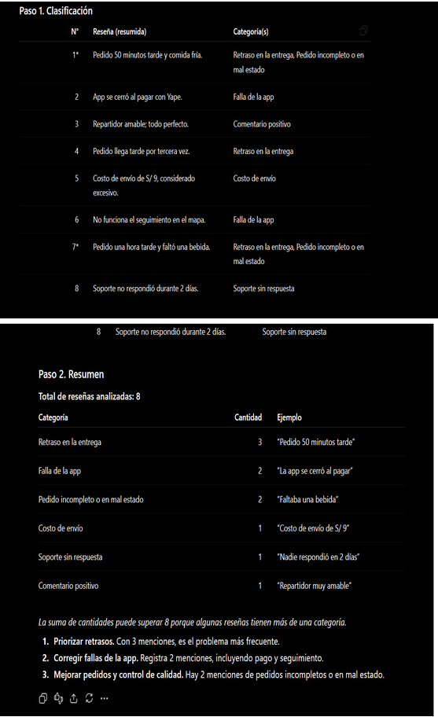

#Pregunta2

Prompt inicial:
Solo dame los  monto finales sin explicacionse 
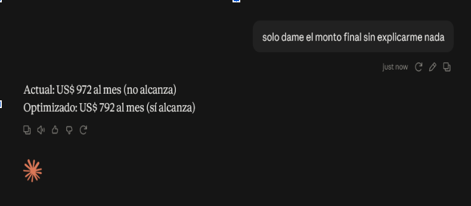

prompt final:

.rol;Actúa como analista de financiero de TI
<system note> Antes de empezar quiero que revises tus calculos de este problema antes de enviar tu respuesta y quiero que hagas los calculos a mano, comparando costo mensual actual, costo optimizado, ahorro en porcentaje y si  cada escenario cumple el presupuesto<system note>
<contexto>La empresa EduTech lanzará un chatbot de atención a estudiantes que usa la API de un modelo de lenguaje. El área de finanzas aprobó un presupuesto de US$ 900 mensuales y le pide verificar si alcanza.
Tarea: analiza en dos pasos.<contexto>
<datos>Datos de referencia para el ejercicio:
■ 4,000 consultas por día durante 30 días.
■ Cada consulta envía 1,200 tokens de entrada (pregunta + contexto) y recibe 300 tokens de salida. ■ Precio: US$ 3 por millón de tokens de entrada y US$ 15 por millón de tokens de salida.
■ Propuesta de optimización: reducir el contexto para que la entrada baje a 700 tokens por consulta, sin cambiar la salida.
<datos>
<tarea>Se te pido que analices si el presupuesto de US$ 900 mensuales alcanza y lo verifiques<tarea>
<formato>Quiero que me hagas un resumen del el porque primero como primer paragrafo, un desarrollo del porque y por ultimo la conclucion y decicion final todo esto con palabras tecnicas y formales<formato>

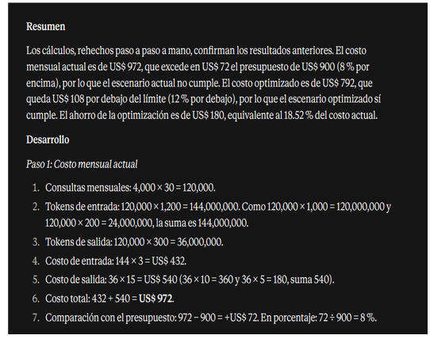
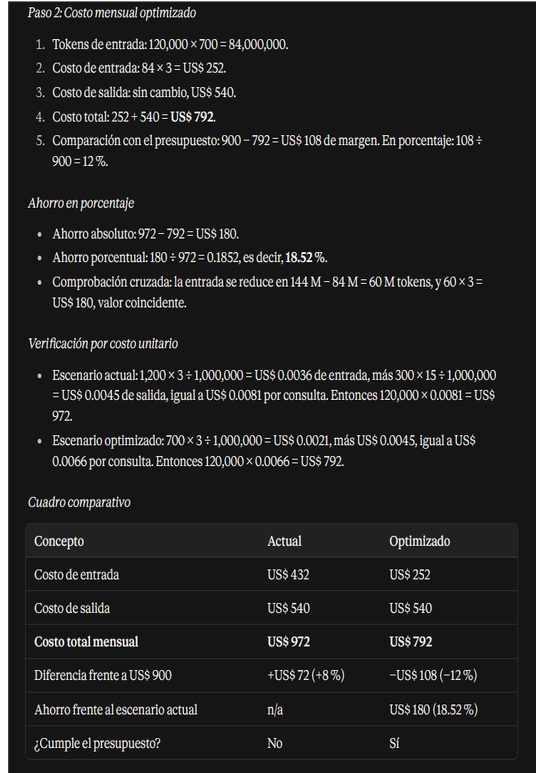
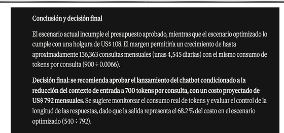

#Pregunta3

Esquema:
{
  "nombre": "string", 
  "puesto": "string", 
  "anios_experiencia": "number", 
  "tecnologias": ["string"], 
  "disponibilidad": "string", 
  "pretension_soles": "number | null" 
}

prompt inicial zero shot:

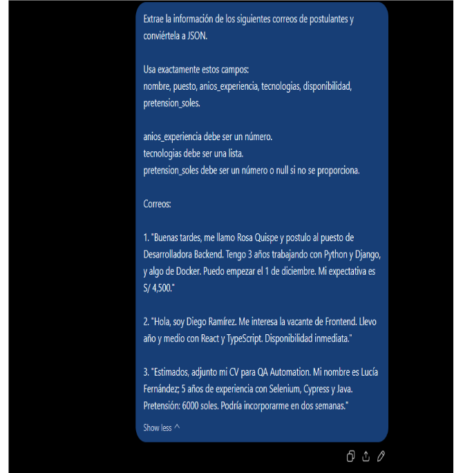
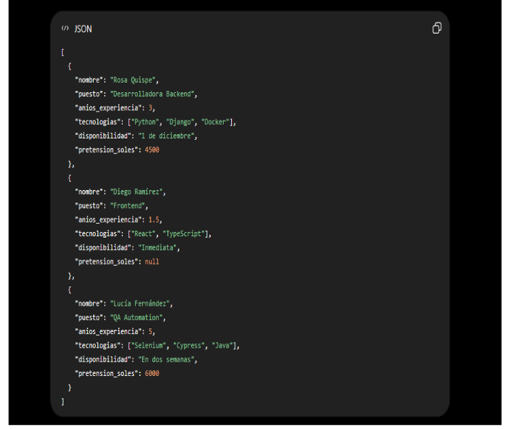

pruebas finales:
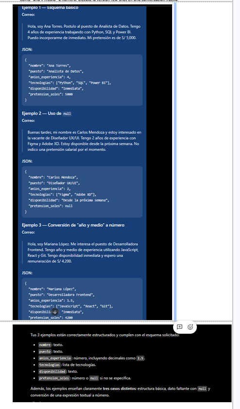
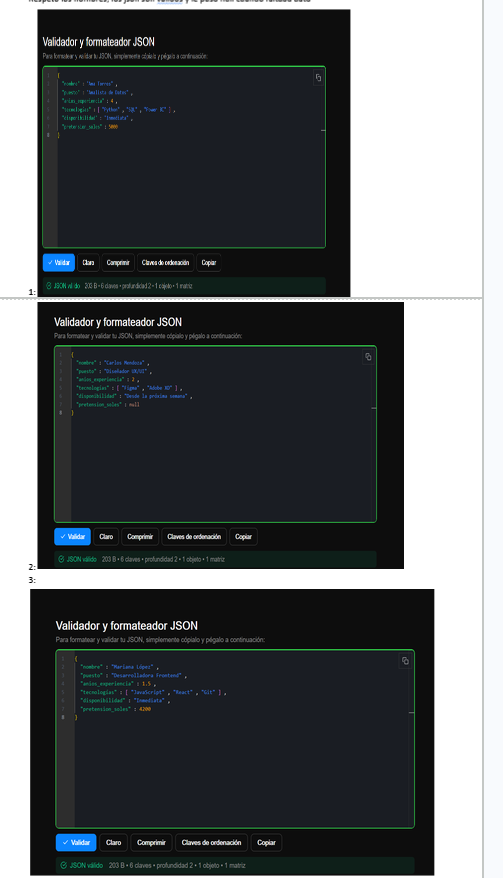

## Diagrama de flujo

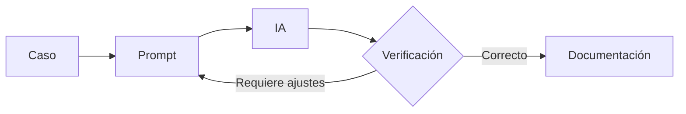
## Entregables completados

- [x] Pregunta 1
- [x] Pregunta 2
- [x] Pregunta 3
- [x] Pregunta 4

| Criterio                                | ChatGPT | Claude | IA libre (Claude) |
| --------------------------------------- | :-----: | :----: | :---------------: |
| Calidad de la respuesta (1-5)           |    4    |   5    |         5         |
| Precisión (aciertos / total verificado) |    5    |   5    |         5         |
| Precio del plan o de la API (US$)       |    4    |   5    |         5         |
| N.° de prompts hasta un resultado útil  |    5    |   4    |         4         |
| Tokens aproximados y costo estimado     |    4    |   4    |         4         |
| **Total**                               | **22**  | **23** |      **23**       |

## CONCLUCION

Claude fue la herramienta que mejor me sirvió, con 23 puntos frente a 22 de ChatGPT. La IA libre que utilize (Que fue claude) obtuvo el mismo total que Claude, lo que es coherente porque ambas usan el mismo modelo. La ventaja sobre ChatGPT se explica por la calidad de la respuesta (5 contra 4) y por el precio (5 contra 4). En precisión las tres herramientas empataron con 5, por lo que la exactitud no definió la diferencia. ChatGPT necesitó menos prompts hasta un resultado útil (5 contra 4), pues acertó más rápido con el prompt inicial, mientras que Claude requirió una iteración adicional para llegar al resultado esperado. En tokens y costo estimado las tres quedaron iguales con 4.

Por tipo de tarea, usaría Claude para redactar documentación, analizar textos largos, explicar código y cálculos que exigen razonamiento paso a paso, como el análisis de costos de la Pregunta 2. Usaría ChatGPT para consultas generales y rápidas, y para tareas en las que se busca un resultado útil con pocos intentos. Usaría la IA libre para práctica, pruebas y tareas simples, donde el costo sea la prioridad. En todos los casos, la verificación del resultado sigue siendo obligatoria, como indica el diagrama de flujo del proyecto.

- Precios de ChatGPT: https://openai.com/chatgpt/pricing
- Precios de Claude: https://claude.com/pricing

 

